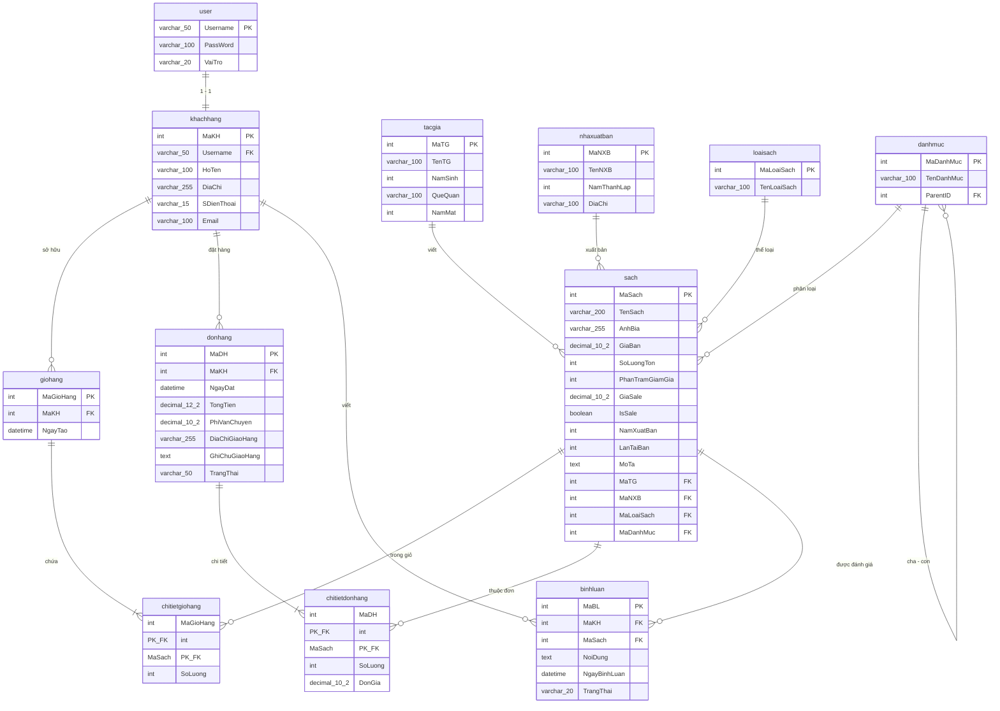
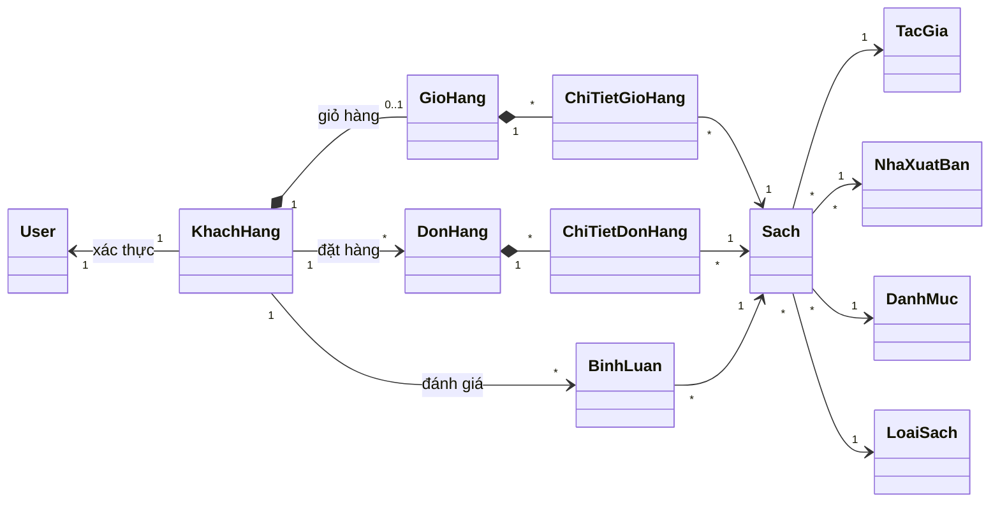
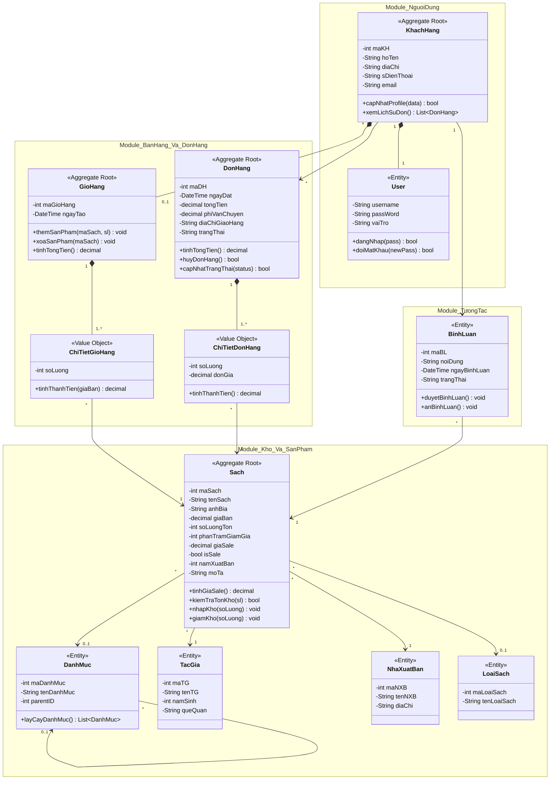
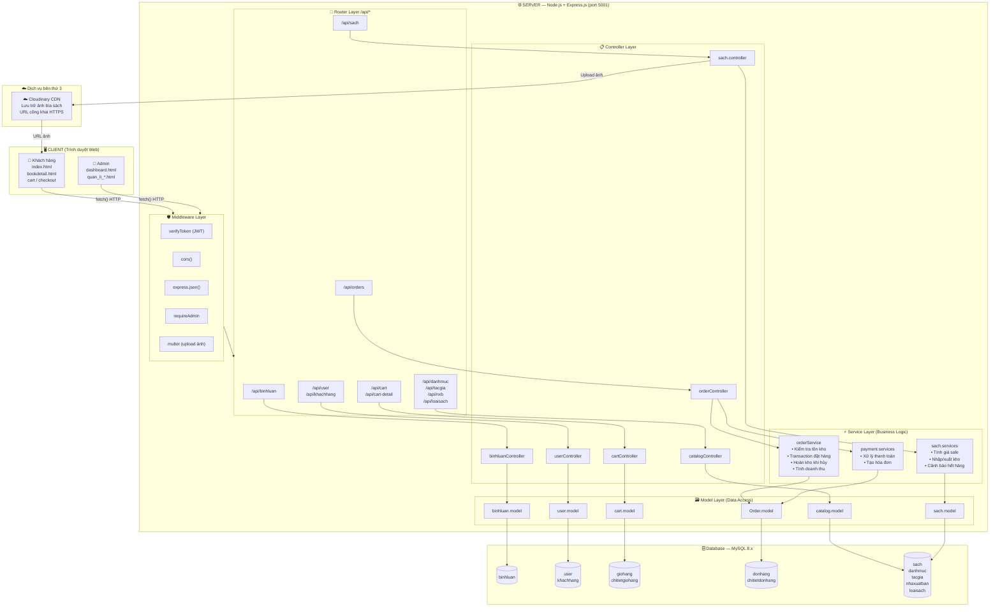
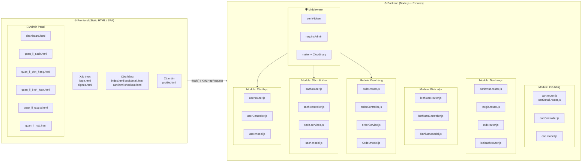
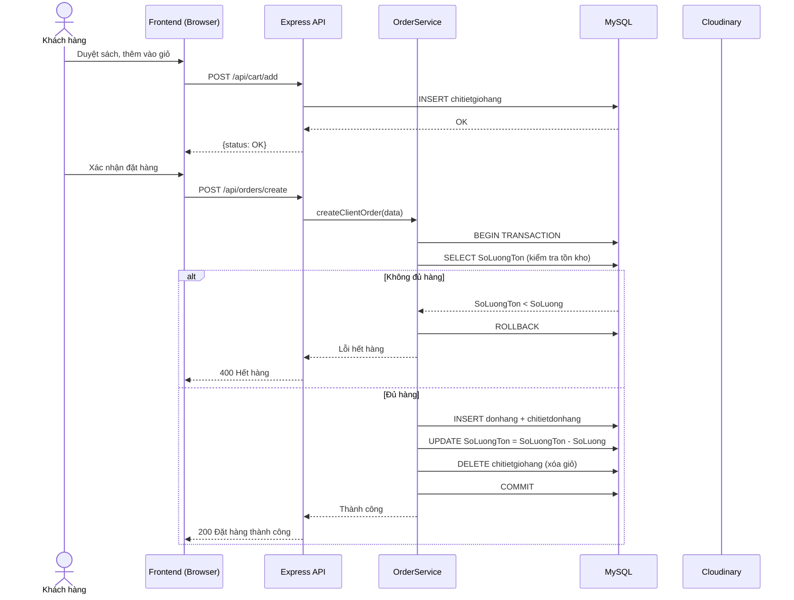
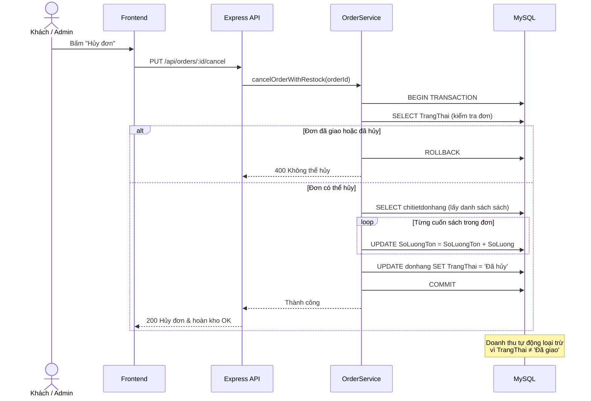

# BÁO CÁO THIẾT KẾ HỆ THỐNG VÀ ĐẶC TẢ KỸ THUẬT RESTFUL API
## (SYSTEM ARCHITECTURE & API SPECIFICATION REPORT)

**Tên Dự án:** Hệ thống Quản lý và Bán Sách Trực Tuyến (Bookstore E-Commerce)  
**Tổ chức / Nhóm thực hiện:** Development & System Engineering Team  
**Phiên bản tài liệu:** 4.0 (Bổ sung Kiến trúc Tổng thể Hệ thống — Deployment, Component & Data Flow Diagrams)  
**Ngày cập nhật:** 12/10/2026  

---

## MỤC LỤC
0. [KIẾN TRÚC TỔNG THỂ HỆ THỐNG](#0-kiến-trúc-tổng-thể-hệ-thống)
1. [TỔNG QUAN VÀ KIẾN TRÚC HỆ THỐNG](#1-tổng-quan-và-kiến-trúc-hệ-thống)
2. [CƠ CHẾ NGHIỆP VỤ CỐT LÕI (KHO & DOANH THU)](#2-cơ-chế-nghiệp-vụ-cốt-lõi-kho--doanh-thu)
3. [THIẾT KẾ CƠ SỞ DỮ LIỆU (DATABASE & ERD)](#3-thiết-kế-cơ-sở-dữ-liệu-database--erd)
4. [THIẾT KẾ HƯỚNG ĐỐI TƯỢNG (UML CLASS DIAGRAM)](#4-thiết-kế-hướng-đối-tượng-uml-class-diagram)
5. [ĐẶC TẢ CHI TIẾT RESTFUL API (API SPECIFICATIONS)](#5-đặc-tả-chi-tiết-restful-api-api-specifications)
6. [BẢO MẬT VÀ QUY TẮC PHÁT TRIỂN](#6-bảo-mật-và-quy-tắc-phát-triển)

---

## 1. TỔNG QUAN VÀ KIẾN TRÚC HỆ THỐNG

### 1.1 Bối cảnh và Mục tiêu
Hệ thống **Bookstore** được thiết kế nhằm số hóa quy trình kinh doanh của nhà sách truyền thống lên nền tảng trực tuyến. Hệ thống xây dựng trên kiến trúc **Client - Server** phân tầng rõ rệt:
* **Backend:** Node.js, Express.js cung cấp RESTful API, giao tiếp với CSDL MySQL qua kết nối Connection Pool (`mysql2/promise`).
* **Frontend:** Single Page Application / Multi-page tĩnh (HTML5, Bootstrap 5, Vanilla JS, Chart.js, SweetAlert2), gọi API không đồng bộ (`async/await fetch`).
* **Database:** MySQL RDBMS chuẩn hóa 3NF, bảo đảm toàn vẹn tham chiếu (ACID).

### 1.2 Kiến trúc 3 Lớp (Layered Architecture)
Hệ thống Backend được phân chia chặt chẽ theo mô hình trách nhiệm:
1. **Routing & Controller Layer (`/src/router`, `/src/controller`):** Tiếp nhận HTTP Request, xác thực dữ liệu đầu vào (Validate params/body), phân quyền Middleware, và trả về HTTP Response chuẩn (JSON).
2. **Service Layer (`/src/services`):** Chứa toàn bộ logic nghiệp vụ (Business Rules), điều phối Transaction (Commit/Rollback), tính toán giá khuyến mãi, kiểm tra và cập nhật tồn kho, xử lý doanh thu.
3. **Data Access / Model Layer (`/src/modules`):** Trực tiếp thực thi câu lệnh SQL với MySQL, quản lý Query Parameterized để triệt tiêu lỗ hổng SQL Injection.

---

## 2. CƠ CHẾ NGHIỆP VỤ CỐT LÕI (KHO & DOANH THU)

### 2.1 Quản lý Tồn kho & Vòng đời Đơn hàng (Inventory Flow)
Hệ thống quản lý tồn kho trực tiếp qua trường `SoLuongTon` của bảng `sach`. Quy trình biến động tồn kho được thiết kế khép kín:

```
[Khách chọn sách vào giỏ] 
       │
       ▼
[Đặt hàng (POST /api/orders/create)] 
       ├─► Kiểm tra: Nếu SoLuongTon < SoLuong ──► [Báo lỗi: Hết hàng / Không đủ SL]
       └─► Đủ hàng: Tạo đơn hàng + Trừ kho: UPDATE sach SET SoLuongTon = SoLuongTon - SoLuong
       │
       ▼
[Trạng thái đơn: ChoDuyet ➔ Đang xử lý ➔ Đang giao ➔ Đã giao]
       │
       ├─► Khi GIAO THÀNH CÔNG: Chốt đơn, tính vào Doanh thu.
       │
       └─► Khi HỦY ĐƠN (PUT /api/orders/:id/cancel):
             ├─► Chuyển trạng thái: TrangThai = 'Đã hủy'
             ├─► Tự động HOÀN KHO: UPDATE sach SET SoLuongTon = SoLuongTon + SoLuong
             └─► Loại trừ hoàn toàn khỏi Doanh thu và Thống kê đơn thành công.
```

* **Lịch sử đơn hàng của người dùng (`GET /api/orders/customer/:maKH` hoặc `GET /api/orders?maKH=...`):** Cho phép khách hàng tra cứu toàn bộ đơn hàng của mình kèm trạng thái xử lý theo thời gian thực và danh sách chi tiết các cuốn sách trong đơn. Khách hàng có thể tự hủy đơn khi đơn ở trạng thái 'ChoDuyet' hoặc 'Chờ xác nhận' hoặc 'Đang xử lý' thông qua `PUT /api/orders/:id/cancel` để tự động hoàn kho tức thời.
* **Xóa món lẻ trong đơn (`DELETE /api/orders/:id/items/:bookId`):** Khi Admin xóa 1 cuốn sách khỏi đơn hàng chưa giao, hệ thống tự động hoàn lại số lượng sách đó về kho và tính lại tổng tiền đơn hàng.
* **Cảnh báo hết hàng:** Hệ thống tự động lọc các mặt hàng có `SoLuongTon < 10` để hiển thị trên Dashboard Admin, hỗ trợ nhập hàng nhanh (`PUT /api/sach/:id/nhap-hang`).

### 2.2 Quy tắc Tính toán Doanh thu Chuẩn
* **Điều kiện tính Doanh thu:** Chỉ các đơn hàng có trạng thái **`TrangThai = 'Đã giao'`** mới được tính vào doanh thu thực tế.
* Các đơn mới đặt (`ChoDuyet`), đang giao (`Đang giao`), hoặc đã hủy (`Đã hủy`) **không bao giờ** được ghi nhận là doanh thu.
* Trên Dashboard:
  * **Tổng doanh thu tháng (`monthlyRevenue`):** Tính tổng `TongTien` các đơn có `TrangThai = 'Đã giao'` trong tháng và năm hiện tại.
  * **Tổng đơn hàng trong tháng (`monthlyOrderCount`):** Tự động loại trừ các đơn `TrangThai = 'Đã hủy'`.
  * **Biểu đồ doanh thu 7 ngày:** Nhóm dữ liệu theo ngày đặt trong 7 ngày gần nhất với điều kiện `TrangThai = 'Đã giao'`.

---

## 3. THIẾT KẾ CƠ SỞ DỮ LIỆU (DATABASE & ERD)

### 3.1 Sơ đồ Thực thể Quan hệ (ERD - Entity Relationship Diagram)



### 3.2 Bảng Đặc tả Chi tiết các Bảng CSDL

| Tên Bảng | Thuộc tính (Cột) | Kiểu dữ liệu | Ràng buộc | Ý nghĩa / Ghi chú |
| :--- | :--- | :--- | :--- | :--- |
| **`user`** | `Username` <br> `PassWord` <br> `VaiTro` | VARCHAR(50) <br> VARCHAR(100) <br> VARCHAR(20) | PK <br> NOT NULL <br> DEFAULT 'customer' | Tài khoản đăng nhập, mật khẩu mã hóa bcrypt |
| **`khachhang`** | `MaKH` <br> `Username` <br> `HoTen` <br> `DiaChi` <br> `SDienThoai` <br> `Email` | INT <br> VARCHAR(50) <br> VARCHAR(100) <br> VARCHAR(255) <br> VARCHAR(15) <br> VARCHAR(100) | PK, AUTO_INCREMENT <br> FK -> user(Username), UNIQUE <br> NOT NULL <br> NULL <br> NULL <br> NULL | Hồ sơ cá nhân khách hàng, liên kết 1-1 với `user` |
| **`sach`** | `MaSach` <br> `TenSach` <br> `AnhBia` <br> `GiaBan` <br> `SoLuongTon` <br> `PhanTramGiamGia` <br> `GiaSale` <br> `IsSale` <br> `NamXuatBan` <br> `MoTa` <br> `MaTG` <br> `MaNXB` <br> `MaLoaiSach` <br> `MaDanhMuc` | INT <br> VARCHAR(200) <br> VARCHAR(255) <br> DECIMAL(10,2) <br> INT <br> INT <br> DECIMAL(10,2) <br> BOOLEAN <br> INT <br> TEXT <br> INT <br> INT <br> INT <br> INT | PK, AUTO_INCREMENT <br> NOT NULL <br> NULL <br> NOT NULL, DEFAULT 0 <br> DEFAULT 0 <br> DEFAULT 0 <br> NULL <br> DEFAULT FALSE <br> NULL <br> NULL <br> FK -> tacgia <br> FK -> nhaxuatban <br> FK -> loaisach <br> FK -> danhmuc | Thông tin sách, quản lý giá sale, số lượng tồn kho |
| **`danhmuc`** | `MaDanhMuc` <br> `TenDanhMuc` <br> `ParentID` | INT <br> VARCHAR(100) <br> INT | PK, AUTO_INCREMENT <br> NOT NULL <br> FK -> danhmuc(MaDanhMuc) | Cây danh mục cha - con đa cấp |
| **`tacgia`** | `MaTG` <br> `TenTG` <br> `NamSinh` <br> `QueQuan` <br> `NamMat` | INT <br> VARCHAR(100) <br> INT <br> VARCHAR(100) <br> INT | PK, AUTO_INCREMENT <br> NOT NULL <br> NULL <br> NULL <br> NULL | Tác giả sách |
| **`nhaxuatban`** | `MaNXB` <br> `TenNXB` <br> `NamThanhLap` <br> `DiaChi` | INT <br> VARCHAR(100) <br> INT <br> VARCHAR(100) | PK, AUTO_INCREMENT <br> NOT NULL <br> NULL <br> NULL | Nhà xuất bản |
| **`loaisach`** | `MaLoaiSach` <br> `TenLoaiSach` | INT <br> VARCHAR(100) | PK, AUTO_INCREMENT <br> NOT NULL | Phân loại bổ trợ (SGK, Giáo trình...) |
| **`giohang`** | `MaGioHang` <br> `MaKH` <br> `NgayTao` | INT <br> INT <br> DATETIME | PK, AUTO_INCREMENT <br> FK -> khachhang <br> DEFAULT CURRENT_TIMESTAMP | Giỏ hàng mua sắm |
| **`chitietgiohang`** | `MaGioHang` <br> `MaSach` <br> `SoLuong` | INT <br> INT <br> INT | PK, FK -> giohang <br> PK, FK -> sach <br> NOT NULL, DEFAULT 1 | Chi tiết các cuốn sách trong giỏ |
| **`donhang`** | `MaDH` <br> `MaKH` <br> `NgayDat` <br> `TongTien` <br> `PhiVanChuyen` <br> `DiaChiGiaoHang` <br> `GhiChuGiaoHang` <br> `TrangThai` | INT <br> INT <br> DATETIME <br> DECIMAL(12,2) <br> DECIMAL(10,2) <br> VARCHAR(255) <br> TEXT <br> VARCHAR(50) | PK, AUTO_INCREMENT <br> FK -> khachhang <br> DEFAULT CURRENT_TIMESTAMP <br> NOT NULL <br> DEFAULT 0.00 <br> NOT NULL <br> NULL <br> DEFAULT 'ChoDuyet' | Đơn đặt hàng, trạng thái: ChoDuyet, Đang giao, Đã giao, Đã hủy |
| **`chitietdonhang`** | `MaDH` <br> `MaSach` <br> `SoLuong` <br> `DonGia` | INT <br> INT <br> INT <br> DECIMAL(10,2) | PK, FK -> donhang <br> PK, FK -> sach <br> NOT NULL, DEFAULT 1 <br> NOT NULL | Chi tiết sản phẩm trong đơn hàng, lưu giá thực tế tại thời điểm mua |
| **`binhluan`** | `MaBL` <br> `MaKH` <br> `MaSach` <br> `NoiDung` <br> `NgayBinhLuan` <br> `TrangThai` | INT <br> INT <br> INT <br> TEXT <br> DATETIME <br> VARCHAR(20) | PK, AUTO_INCREMENT <br> FK -> khachhang <br> FK -> sach <br> NOT NULL <br> DEFAULT CURRENT_TIMESTAMP <br> DEFAULT 'pending' | Đánh giá & bình luận, có kiểm duyệt (pending/approved) |

*Tài liệu đính kèm:* File DDL sạch đã kiểm tra lỗi cú pháp lưu tại: `Backend/database/schema_clean.sql`. Sơ đồ vector độ nét cao lưu tại: `Backend/database/schema_erd.svg`.

---

## 4. THIẾT KẾ HƯỚNG ĐỐI TƯỢNG (UML CLASS DIAGRAM)

### 4.1 Sơ đồ Tổng quát (High-Level Domain Model)
Sơ đồ bao quát thể hiện các thực thể chính và liên kết luồng dữ liệu toàn hệ thống:



### 4.2 Sơ đồ Chi tiết theo Phân hệ (Detailed Package Class Diagram)



---

## 5. ĐẶC TẢ CHI TIẾT RESTFUL API (API SPECIFICATIONS)

### 5.1 Quy chuẩn Kỹ thuật Chung
* **Base URL:** `http://localhost:5001/api`
* **Content-Type:** `application/json` (trừ API tải ảnh bìa dùng `multipart/form-data`)
* **Xác thực (Authentication):** Header `Authorization: Bearer <JWT_TOKEN>`
* **Cấu trúc JSON Response thành công:**
  ```json
  {
    "status": "OK",
    "message": "Thông báo thành công",
    "data": { ... }
  }
  ```
* **Cấu trúc JSON Response thất bại:**
  ```json
  {
    "status": "ERROR",
    "message": "Chi tiết lỗi"
  }
  ```

---

### 5.2 Danh mục Endpoints Chi tiết

#### Phân hệ 1: Sách & Tồn kho (`/api/sach`)
| Endpoint | Method | Quyền | Params / Body | Mô tả chức năng | Mã HTTP |
| :--- | :---: | :---: | :--- | :--- | :---: |
| `/api/sach` | `GET` | Public | None | Lấy danh sách tất cả các cuốn sách (kèm thông tin tác giả, NXB, danh mục, giá sale) | `200` |
| `/api/sach/:id` | `GET` | Public | Path: `id` | Xem chi tiết 1 cuốn sách theo mã | `200`, `404` |
| `/api/sach/related/:id` | `GET` | Public | Path: `id` | Lấy 4 cuốn sách liên quan cùng loại | `200` |
| `/api/sach` | `POST` | Admin | Form-data: `TenSach, GiaBan, SoLuongTon, MaTG, MaNXB, MaDanhMuc, PhanTramGiamGia, AnhBia (File)` | Thêm sách mới, tự động upload ảnh lên Cloudinary và tính giá Sale | `201`, `500` |
| `/api/sach/:id` | `PUT` | Admin | Form-data tương tự POST | Cập nhật thông tin sách | `200`, `500` |
| `/api/sach/:id` | `DELETE` | Admin | Path: `id` | Xóa cuốn sách khỏi cơ sở dữ liệu | `200`, `500` |
| `/api/sach/:id/nhap-hang` | `PUT` | Admin | Body: `{"soLuong": 50}` | **Nhập hàng vào kho:** Cộng thêm số lượng tồn kho `SoLuongTon = SoLuongTon + ?` | `200`, `400` |
| `/api/sach/thong-ke/sap-het-hang` | `GET` | Admin | None | Lấy số lượng và danh sách sách có tồn kho `< 10` | `200` |
| `/api/sach/thong-ke/bieu-do` | `GET` | Admin | None | Thống kê doanh thu 7 ngày và Top 5 sách bán chạy | `200` |

#### Phân hệ 2: Đơn hàng & Doanh thu (`/api/orders`)
| Endpoint | Method | Quyền | Params / Body | Mô tả chức năng | Mã HTTP |
| :--- | :---: | :---: | :--- | :--- | :---: |
| `/api/orders` | `GET` | Admin | Query: `maKH` (tùy chọn) | Lấy danh sách tất cả các đơn hàng trong hệ thống (hoặc lọc theo khách hàng nếu truyền `maKH`) | `200` |
| `/api/orders/customer/:maKH` | `GET` | User/Admin | Path: `maKH` | **Lịch sử đơn hàng của khách hàng:** Lấy danh sách đơn hàng của khách kèm chi tiết sách trong từng đơn | `200` |
| `/api/orders/:id` | `GET` | User/Admin | Path: `id` | Xem thông tin chi tiết đơn hàng và danh sách các cuốn sách trong đơn | `200`, `404` |
| `/api/orders/create` | `POST` | User | Body: `{"MaKH": 1, "TenNguoiNhan": "A", "SDT": "...", "DiaChiGiaoHang": "...", "GhiChu": "..."}` | **Đặt hàng mới:** Kiểm tra tồn kho, trừ `SoLuongTon`, tạo đơn, tạo chi tiết đơn, xóa giỏ | `200`, `400` |
| `/api/orders/:id/status` | `PUT` | Admin | Body: `{"status": "Đang giao"}` | Cập nhật trạng thái đơn (Nếu chuyển sang 'Đã hủy' sẽ kích hoạt hoàn kho) | `200`, `400` |
| `/api/orders/:id/cancel` | `PUT` | User/Admin | Path: `id` | **Hủy đơn hàng:** Đổi trạng thái sang 'Đã hủy', tự động cộng hoàn trả lại `SoLuongTon` | `200`, `400` |
| `/api/orders/:id/items/:bookId` | `DELETE`| Admin | Path: `id, bookId` | Xóa 1 cuốn sách khỏi đơn, hoàn lại kho cho sách đó và tính lại tổng tiền đơn | `200`, `400` |
| `/api/orders/best-sellers` | `GET` | Admin | None | Thống kê Top 5 sách bán chạy nhất dựa trên các đơn đã giao | `200` |

#### Phân hệ 3: Giỏ hàng (`/api/cart` & `/api/cart-detail`)
| Endpoint | Method | Quyền | Params / Body | Mô tả chức năng | Mã HTTP |
| :--- | :---: | :---: | :--- | :--- | :---: |
| `/api/cart/:maKH` | `GET` | User | Path: `maKH` | Lấy danh sách sách trong giỏ hàng của khách kèm giá thực tế (đã giảm) | `200` |
| `/api/cart/add` | `POST` | User | Body: `{"MaKH": 1, "MaSach": 10, "SoLuong": 1}` | Thêm sách vào giỏ hàng (cộng dồn nếu đã có) | `200`, `400` |
| `/api/cart-detail/add` | `POST` | User | Body: `{"MaGioHang": 1, "MaSach": 10, "SoLuong": 1}` | Thêm chi tiết vào giỏ hàng | `200`, `400` |
| `/api/cart-detail/update` | `POST` | User | Body: `{"MaGioHang": 1, "MaSach": 10, "SoLuong": 3}` | Cập nhật số lượng của cuốn sách trong giỏ hàng | `200` |
| `/api/cart-detail/remove` | `POST` | User | Body: `{"MaGioHang": 1, "MaSach": 10}` | Xóa sản phẩm ra khỏi giỏ hàng | `200` |
| `/api/cart-detail/:MaGioHang` | `GET` | User | Path: `MaGioHang` | Lấy chi tiết toàn bộ sản phẩm trong 1 giỏ hàng | `200` |

> **Lưu ý:** Prefix thực tế trong code là `/api/cart-detail` (không phải `/api/cartDetail`), và module này chỉ expose các route `POST` (`add/update/remove`) + `GET /:MaGioHang`, không có `PUT`/`DELETE` theo id chi tiết.

#### Phân hệ 4: Danh mục & Phụ trợ (CRUD đầy đủ)
| Endpoint | Method | Quyền | Params / Body | Mô tả chức năng | Mã HTTP |
| :--- | :---: | :---: | :--- | :--- | :---: |
| `/api/danhmuc` | `GET` | Public | None | Lấy danh sách cây danh mục sách | `200` |
| `/api/danhmuc/:id` | `GET` | Public | Path: `id` | Xem chi tiết 1 danh mục | `200`, `404` |
| `/api/danhmuc` | `POST` | Admin | Body: `{"TenDanhMuc": "...", "ParentID": null}` | Thêm danh mục mới | `201` |
| `/api/danhmuc/:id` | `PUT` | Admin | Body: `{"TenDanhMuc": "...", "ParentID": ...}` | Cập nhật danh mục | `200` |
| `/api/danhmuc/:id` | `DELETE` | Admin | Path: `id` | Xóa danh mục | `200` |
| `/api/tacgia` | `GET` | Public | None | Lấy danh sách tác giả | `200` |
| `/api/tacgia/:id` | `GET` | Public | Path: `id` | Xem chi tiết tác giả | `200`, `404` |
| `/api/tacgia` | `POST` | Admin | Body: `{"TenTG": "...", "NamSinh": ..., "QueQuan": "..."}` | Thêm tác giả | `201` |
| `/api/tacgia/:id` | `PUT` | Admin | Body tương tự POST | Cập nhật tác giả | `200` |
| `/api/tacgia/:id` | `DELETE` | Admin | Path: `id` | Xóa tác giả | `200` |
| `/api/nxb` | `GET` | Public | None | Lấy danh sách nhà xuất bản | `200` |
| `/api/nxb` | `POST` | Admin | Body: `{"TenNXB": "...", "DiaChi": "..."}` | Thêm nhà xuất bản | `201` |
| `/api/nxb/:id` | `PUT` | Admin | Body tương tự POST | Cập nhật nhà xuất bản | `200` |
| `/api/nxb/:id` | `DELETE` | Admin | Path: `id` | Xóa nhà xuất bản | `200` |
| `/api/loaisach` | `GET` | Public | None | Lấy danh sách loại sách | `200` |
| `/api/loaisach/:id` | `GET` | Public | Path: `id` | Xem chi tiết loại sách | `200`, `404` |
| `/api/loaisach` | `POST` | Admin | Body: `{"TenLoaiSach": "..."}` | Thêm loại sách | `201` |
| `/api/loaisach/:id` | `PUT` | Admin | Body tương tự POST | Cập nhật loại sách | `200` |
| `/api/loaisach/:id` | `DELETE` | Admin | Path: `id` | Xóa loại sách | `200` |

#### Phân hệ 5: Xác thực & Khách hàng
| Endpoint | Method | Quyền | Params / Body | Mô tả chức năng | Mã HTTP |
| :--- | :---: | :---: | :--- | :--- | :---: |
| `/api/user/signup` | `POST` | Public | Body: `{"Username": "...", "PassWord": "...", "HoTen": "...", "Email": "..."}` | Đăng ký tài khoản mới, mã hóa mật khẩu bcrypt, tạo hồ sơ khách hàng | `201`, `400` |
| `/api/user/admin/signup` | `POST` | Admin | Body tương tự signup | Admin tạo tài khoản admin khác (yêu cầu `verifyToken` + `requireAdmin`) | `201`, `403` |
| `/api/user/login` | `POST` | Public | Body: `{"Username": "...", "PassWord": "..."}` | Đăng nhập, kiểm tra hash mật khẩu, cấp phát JSON Web Token (JWT) | `200`, `400` |
| `/api/khachhang` | `GET` | Admin | None | Lấy danh sách toàn bộ khách hàng | `200` |
| `/api/khachhang` | `POST` | Admin | Body: `{"Username": "...", "HoTen": "...", ...}` | Admin tạo hồ sơ khách hàng mới | `201` |
| `/api/khachhang/:id` | `GET` | User | Path: `id` | Xem thông tin hồ sơ cá nhân của khách | `200`, `404` |
| `/api/khachhang/:id` | `PUT` | User | Body: `{"HoTen": "...", "DiaChi": "...", "SDienThoai": "..."}` | Cập nhật thông tin hồ sơ cá nhân | `200` |
| `/api/khachhang/:id` | `DELETE` | Admin | Path: `id` | Xóa hồ sơ khách hàng | `200` |

> **Lưu ý:** Route đăng ký thực tế trong code là `/api/user/signup` (không phải `/register` như bản tài liệu trước).

#### Phân hệ 6: Bình luận & Tương tác (`/api/binhluan`)
| Endpoint | Method | Quyền | Params / Body | Mô tả chức năng | Mã HTTP |
| :--- | :---: | :---: | :--- | :--- | :---: |
| `/api/binhluan/:MaSach` | `GET` | Public | Path: `MaSach` | Lấy danh sách bình luận đã được duyệt (`TrangThai = 'approved'`) theo sách | `200` |
| `/api/binhluan` | `POST` | User | Body: `{"MaKH": 1, "MaSach": 10, "NoiDung": "..."}` | Đăng bình luận mới (mặc định trạng thái `pending`) | `201` |
| `/api/binhluan` | `GET` | Admin | None | Admin xem toàn bộ bình luận chờ duyệt | `200` |
| `/api/binhluan/:id/status` | `PUT` | Admin | Body: `{"trangThai": "approved"}` | Duyệt hoặc từ chối bình luận | `200` |
| `/api/binhluan/admin/delete/:id` | `DELETE` | Admin | Path: `id` | Admin xóa (ẩn) bình luận vi phạm | `200` |

> **Lưu ý:** Path lấy bình luận theo sách thực tế là `GET /api/binhluan/:MaSach` (không có tiền tố `/book/`).

#### Phân hệ 7: Trang quản trị (Server-rendered HTML — `/admin`)
| Endpoint | Method | Quyền | Mô tả chức năng |
| :--- | :---: | :---: | :--- |
| `/admin/dashboard` | `GET` | Admin | Trả HTML trang Dashboard thống kê |
| `/admin/quan-li-sach` | `GET` | Admin | Trang quản lý sách |
| `/admin/quan-li-loai-sach` | `GET` | Admin | Trang quản lý loại sách |
| `/admin/quan-li-nxb` | `GET` | Admin | Trang quản lý nhà xuất bản |
| `/admin/quan-li-don-hang` | `GET` | Admin | Trang quản lý đơn hàng |
| `/admin/quan-li-binh-luan` | `GET` | Admin | Trang quản lý/duyệt bình luận |
| `/admin/quan-li-phan-hoi` | `GET` | Admin | Trang quản lý phản hồi |
| `/admin/quan-li-tacgia` | `GET` | Admin | Trang quản lý tác giả |

> **Lưu ý:** Đây là các route phục vụ giao diện HTML (không trả JSON), khác bản chất với các API `/api/...` ở trên nên được tách phân hệ riêng.

### 5.3 Module tồn tại nhưng chưa được kết nối (Dead Code)
Hai router sau đã được viết trong code nhưng **chưa được `import`/`use` trong `Backend/src/index.js`**, do đó không hoạt động trên thực tế:
* `Backend/src/router/hoadon.router.js` — `POST /` → `createHD` (tạo hóa đơn).
* `Backend/src/router/payment.router.js` — `POST /checkout` → `thanhToan` (xử lý thanh toán).

Cần quyết định: (a) mount 2 router này vào `index.js` nếu nghiệp vụ hóa đơn/thanh toán vẫn cần dùng, hoặc (b) xóa bỏ nếu đã lỗi thời, để tránh code chết gây nhiễu khi đọc hiểu hệ thống.

---

## 6. BẢO MẬT VÀ QUY TẮC PHÁT TRIỂN

1. **Bảo mật Mật khẩu (Password Hashing):** Sử dụng thư viện `bcrypt` với muối (salt rounds = 10) để băm mật khẩu trước khi lưu trữ vào bảng `user`. Tuyệt đối không lưu mật khẩu dạng văn bản thô (Plaintext).
2. **Xác thực Phiên làm việc (Stateless JWT):** Sử dụng `jsonwebtoken` để mã hóa thông tin người dùng (`Username`, `VaiTro`, `MaKH`). Token được gắn thời hạn hiệu lực và xác thực thông qua Middleware tại các Route nhạy cảm.
3. **Phòng chống SQL Injection:** Toàn bộ các truy vấn CSDL đều sử dụng cơ chế Prepared Statements / Parameterized Queries (`pool.query(sql, [param1, param2])`) thông qua thư viện `mysql2`.
4. **Bảo toàn Dữ liệu Giao dịch (Transaction Integrity):** Các luồng nghiệp vụ phức tạp như **Đặt hàng** (`createClientOrder`) và **Hủy đơn** (`cancelOrderWithRestock`) đều được bọc trong SQL Transaction (`beginTransaction ➔ commit ➔ rollback`). Nếu xảy ra bất kỳ lỗi nào giữa chừng, toàn bộ thay đổi về đơn hàng và kho sách đều được khôi phục nguyên trạng.

---

## 0. KIẾN TRÚC TỔNG THỂ HỆ THỐNG

> *Phần này tổng hợp toàn bộ bức tranh kiến trúc của hệ thống Bookstore, được trình bày qua 4 góc nhìn: Deployment, Component, Data Flow và Technology Stack.*

---

### 0.1 Sơ đồ Triển khai (Deployment Diagram)

Thể hiện cách các thành phần vật lý/logic của hệ thống được triển khai và giao tiếp với nhau trên môi trường thực tế:



---

### 0.2 Sơ đồ Thành phần (Component Diagram)

Thể hiện cấu trúc nội bộ của Backend và Frontend theo từng module chức năng:



---

### 0.3 Luồng Dữ liệu Chính (Data Flow Diagram — Mức 1)

#### 0.3.1 Luồng Mua hàng (Customer Purchase Flow)



#### 0.3.2 Luồng Hủy đơn & Hoàn kho (Cancellation & Restock Flow)



---

### 0.4 Kiến trúc Phân tầng Chi tiết (Layered Architecture Detail)

```
┌─────────────────────────────────────────────────────────────────┐
│                    PRESENTATION LAYER                           │
│  ┌─────────────────┐  ┌──────────────────┐  ┌───────────────┐  │
│  │   Admin Panel   │  │  Customer Store  │  │  Auth Pages   │  │
│  │ dashboard.html  │  │ index / detail / │  │ login.html    │  │
│  │ quan_li_*.html  │  │ cart / checkout  │  │ signup.html   │  │
│  └────────┬────────┘  └────────┬─────────┘  └──────┬────────┘  │
│           └───────────────────┼───────────────────┘           │
│                    fetch() / async-await                       │
├───────────────────────────────┼─────────────────────────────────┤
│                    ROUTING & MIDDLEWARE LAYER                   │
│  ┌──────────────┐  ┌──────────────┐  ┌─────────────────────┐   │
│  │  cors()      │  │  JWT Verify  │  │  requireAdmin       │   │
│  │  json parser │  │  verifyToken │  │  multer + Cloudinary│   │
│  └──────────────┘  └──────────────┘  └─────────────────────┘   │
│         ↓                   ↓                    ↓             │
│  Express Router: /api/sach  /api/orders  /api/cart  /api/user  │
├─────────────────────────────────────────────────────────────────┤
│                    CONTROLLER LAYER                             │
│  sach.controller.js    orderController.js    cartController.js  │
│  • Validate input      • Parse params        • Auth check       │
│  • Call Service        • Error handling      • Format response  │
├─────────────────────────────────────────────────────────────────┤
│                    SERVICE LAYER (Business Logic)               │
│  sach.services.js      orderService.js       payment.services   │
│  • Tính giá sale       • Transaction mgmt    • Kiểm tra hàng   │
│  • Nhập/xuất kho       • Hoàn kho khi hủy    • Tính doanh thu  │
├─────────────────────────────────────────────────────────────────┤
│                    MODEL / DATA ACCESS LAYER                    │
│  sach.model.js         Order.model.js        cart.model.js      │
│  • SQL Parameterized   • Connection Pool     • ACID Compliance  │
│  • mysql2/promise      • Error propagation   • Type mapping     │
├─────────────────────────────────────────────────────────────────┤
│                    DATA LAYER                                   │
│  ┌──────────────────────────────┐  ┌──────────────────────────┐ │
│  │  MySQL (Relational DB)       │  │  Cloudinary (Object CDN) │ │
│  │  user, khachhang, sach       │  │  Ảnh bìa sách (JPG/PNG)  │ │
│  │  donhang, chitiet*, binhluan │  │  URL công khai (HTTPS)   │ │
│  └──────────────────────────────┘  └──────────────────────────┘ │
└─────────────────────────────────────────────────────────────────┘
```

---

### 0.5 Bảng Công nghệ & Thư viện (Technology Stack)

| Lớp | Công nghệ / Thư viện | Phiên bản | Mục đích sử dụng |
| :--- | :--- | :---: | :--- |
| **Runtime** | Node.js | ≥ 18.x | Môi trường thực thi JavaScript phía máy chủ |
| **Framework** | Express.js | 4.x | HTTP Server, Routing, Middleware pipeline |
| **Database** | MySQL | 8.x | Lưu trữ dữ liệu quan hệ (RDBMS), hỗ trợ Transaction |
| **DB Driver** | mysql2/promise | 3.x | Kết nối MySQL từ Node.js, hỗ trợ async/await & Connection Pool |
| **Xác thực** | jsonwebtoken (JWT) | 9.x | Phát hành và xác thực token phiên làm việc stateless |
| **Bảo mật** | bcrypt | 5.x | Băm mật khẩu người dùng (salt rounds = 10) |
| **Upload ảnh** | multer | 1.x | Parse multipart/form-data, nhận file upload |
| **CDN ảnh** | Cloudinary SDK | 2.x | Lưu trữ và phân phối ảnh bìa sách qua CDN toàn cầu |
| **CORS** | cors | 2.x | Cho phép giao tiếp Cross-Origin từ Frontend |
| **Biến môi trường** | dotenv | 16.x | Quản lý cấu hình (.env) tách biệt khỏi mã nguồn |
| **Frontend UI** | Bootstrap 5 | 5.3 | Layout responsive, component UI có sẵn |
| **Biểu đồ** | Chart.js | 4.x | Vẽ biểu đồ doanh thu, thống kê trên Dashboard |
| **Alert UI** | SweetAlert2 | 11.x | Hiển thị hộp thoại thông báo đẹp, có xác nhận |
| **HTTP Client** | Fetch API | Native | Gọi REST API không đồng bộ từ trình duyệt |

---

### 0.6 Quyết định Thiết kế Quan trọng (Key Design Decisions)

| # | Quyết định | Lý do lựa chọn | Đánh đổi (Trade-off) |
| :---: | :--- | :--- | :--- |
| 1 | **Monolith thay vì Microservices** | Quy mô nhóm nhỏ, phạm vi đồ án, dễ debug và triển khai | Khó scale độc lập từng module khi lượng tải tăng mạnh |
| 2 | **Stateless JWT thay vì Session** | Không cần lưu session server-side, dễ mở rộng ngang (horizontal scale) | Token không thể thu hồi ngay lập tức (cần implement blacklist nếu cần logout tức thì) |
| 3 | **Kho hàng nhúng trong bảng `sach`** | Đơn giản, ít JOIN, phù hợp quy mô hiện tại | Không lưu lịch sử biến động kho theo thời gian (cần bảng `lich_su_kho` nếu audit trail) |
| 4 | **Doanh thu tính theo `TrangThai = 'Đã giao'`** | Phản ánh doanh thu thực nhận, tự động loại trừ đơn hủy | Không phân biệt doanh thu đã thu tiền với chưa thu (cần thêm trường `ngayThanhToan` nếu cần) |
| 5 | **Cloudinary cho ảnh bìa** | Miễn phí gói cơ bản, CDN toàn cầu, URL ổn định, không cần quản lý disk server | Phụ thuộc dịch vụ bên thứ 3, cần API Key, có giới hạn băng thông |
| 6 | **SQL Transaction cho đặt hàng & hủy đơn** | Đảm bảo tính toàn vẹn dữ liệu: kho và đơn hàng luôn nhất quán | Chi phí performance nhỏ do lock row trong quá trình transaction |

